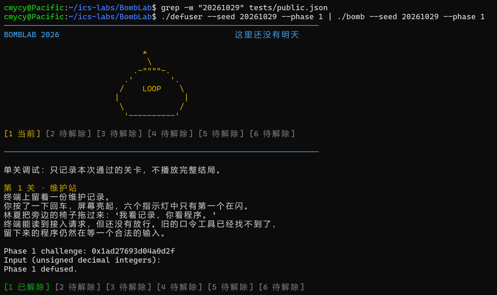
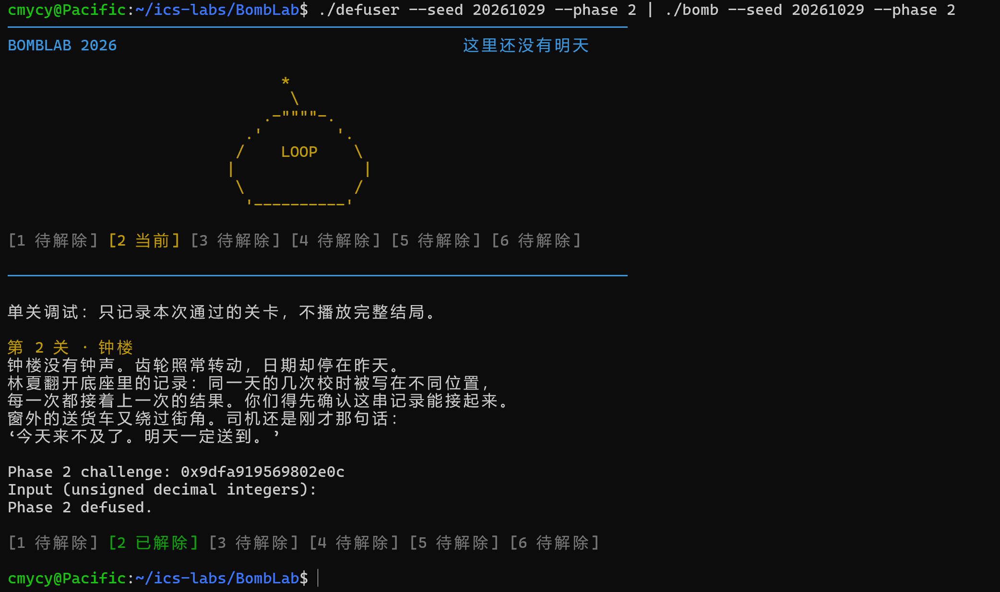
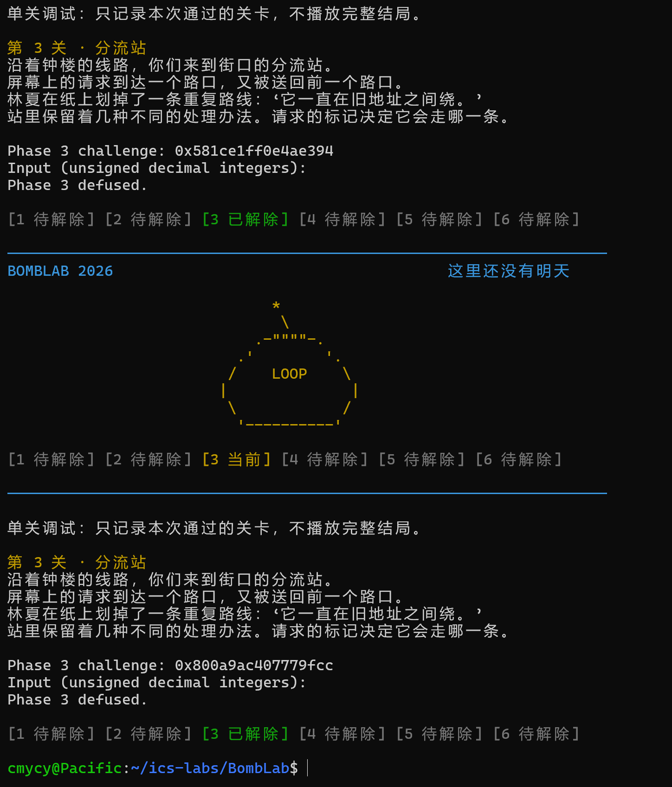
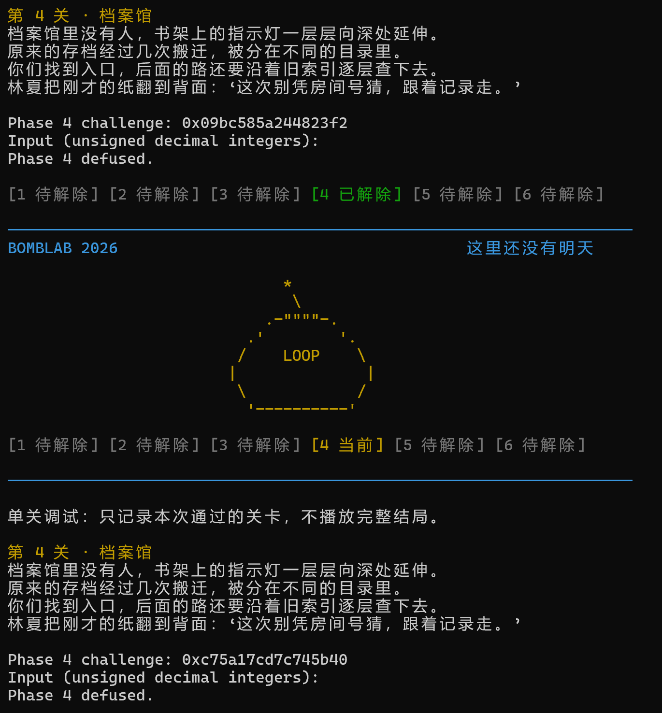
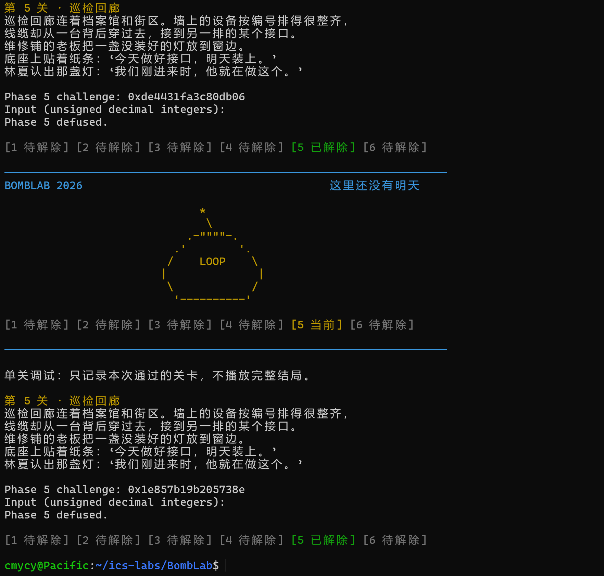
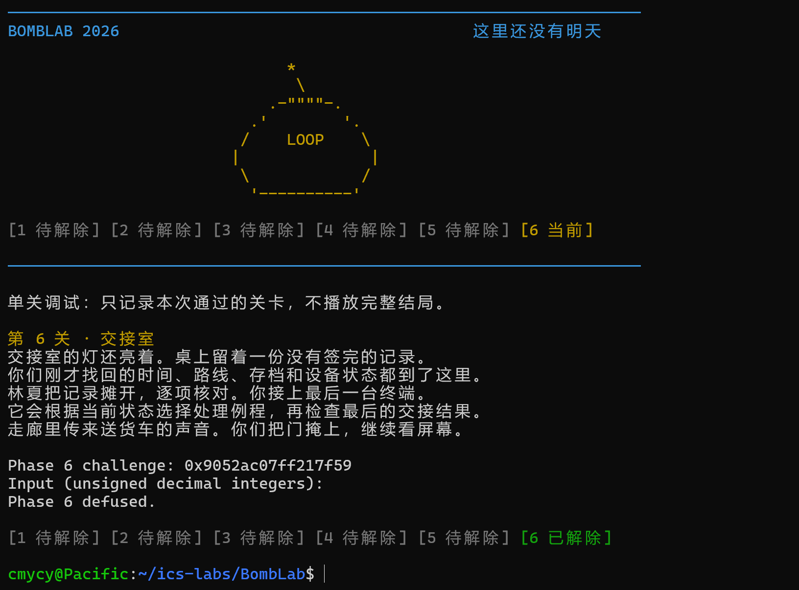
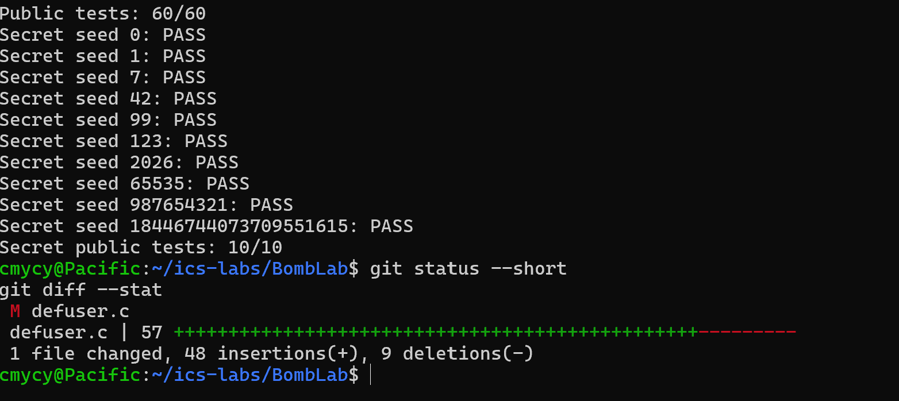

# BombLab 实验报告

## 1. 实验环境与方法

- 环境：Windows 11 + WSL 2（Ubuntu），x86-64。
- 主要工具：`objdump -d -M intel`、`objdump -s`、`nm`、`make`、`public_test.py`。
- 分析方法：先定位每一关的入口函数，再根据 System V AMD64 调用约定跟踪参数和返回值；遇到跳转表、递归和链表时，继续反汇编被调用函数或读取只读数据段。所有运算均按照 `uint32_t` 的模 $2^{32}$ 语义实现。
- 额外验证 seed：`20261029`。它不在 `tests/public.json` 的公开 seed 列表中。

## 2. Phase 1：维护站

### 关键汇编与推理

`phase_01` 只读取一个无符号整数。函数先把 64 位 `challenge` 的不同部分送入 `p1_step0`、`p1_step1`、`p1_step2`，最后把中间结果异或后与输入比较。

令：

```text
lo  = (uint32_t)challenge
hi  = (uint32_t)(challenge >> 32)
mid = (uint32_t)(challenge >> 16)
```

由三个辅助函数中的 `xor`、`lea` 和移位指令恢复出：

```text
s0 = (hi ^ 0x9471) + 8 * lo
s1 = (hi + 4 * mid) ^ 0x786a
s2 = (lo + 0x2022) ^ s1
answer = s2 ^ s0
```

### 非公开 seed 验证

使用 seed `20261029`，challenge 为 `0x1ad27693d04a0d2f`，运行结果为 `Phase 1 defused.`。



## 3. Phase 2：钟楼

### 关键汇编与推理

`phase_02` 使用 `sscanf` 读取 6 个整数。第一项来自 challenge 的一段位域，随后循环五次生成后续项。循环中的 `lea esi,[rsi+rsi*4]` 对应乘 5，`sub esi,edx` 对应减去当前下标。

恢复出的递推关系为：

```text
v[0] = ((challenge >> 6) & 0xf) ^ 0x1f

for i = 1..5:
    shift = 10 + 5 * (i - 1)
    part  = ((challenge >> shift) & 0x3f) + 0xb
    v[i]  = (5 * v[i - 1] - i) ^ part
```

### 非公开 seed 验证

使用 seed `20261029`，challenge 为 `0x9dfa919569802e0c`，运行结果为 `Phase 2 defused.`。



## 4. Phase 3：分流站

### 关键汇编与推理

该关读取两个整数。第一项必须等于 `challenge & 7`，同时它也作为跳转表选择器。先计算：

```text
selector = challenge & 7
mixed = (uint32_t)(challenge >> 32) ^ (uint32_t)(challenge >> 3)
```

`p3_dispatch` 使用 `jmp QWORD PTR [rax*8+...]`，所以不能只按函数地址顺序推断 case。读取跳转表后得到实际映射：

```text
selector 0: (mixed ^ 0x4f1f) + (mixed >> 2)
selector 1: 5 * mixed + 0x461e5
selector 2: (2 * mixed) ^ 0x2429
selector 3: 5 * mixed + 0x39e0
selector 4: 3 * mixed + 0x9ed6
selector 5: 5 * mixed + 0x31420
selector 6: (mixed ^ 0x4458) + (mixed >> 2)
selector 7: (4 * mixed) ^ 0x22a
```

输出依次为 `selector` 和对应分支结果。

### 非公开 seed 验证

使用 seed `20261029`，challenge 为 `0x800a9ac407779fcc`，运行结果为 `Phase 3 defused.`。



## 5. Phase 4：档案馆

### 关键汇编与推理

`phase_04` 只读取一个整数，并调用递归函数 `p4_walk`。入口参数为：

```text
target = challenge & 0x7f
salt = (uint32_t)(challenge >> 7) ^ (uint32_t)(challenge >> 32)
low = 0
high = 127
```

`p4_walk` 先计算中点 `mid = low + ((high - low) >> 1)`。根据目标与中点的关系进入三个分支：

```text
target == mid:
    return (mid + 0x8f) ^ salt

target < mid:
    child = walk(target, low, mid - 1, salt)
    return (5 * child) ^ (mid + salt) ^ 0x9

target > mid:
    child = walk(target, mid + 1, high, salt)
    return (5 * child) ^ (mid + salt) ^ 0x16
```

这相当于沿区间二分路径递归，并在回溯时编码路径。

### 非公开 seed 验证

使用 seed `20261029`，challenge 为 `0xc75a17cd7c745b40`，运行结果为 `Phase 4 defused.`。



## 6. Phase 5：巡检回廊

### 关键汇编与推理

`p5_traverse` 从 `p5_heads` 选择入口，并沿节点指针遍历。通过 `nm` 定位 `p5_heads`、`p5_nodes`，再读取 `.rodata`，恢复出实际链表顺序对应的 `value` 与 `addend`：

```text
value  = 015a,0716,0b66,0925,060f,085f,0252,050a,0a7d,0335,0477,0020
addend = 4b3e,f9b6,096b,6f29,fd2c,0dd3,bf9e,5933,c7d4,f070,b942,52c6
```

入口、额外步数和初始累加值为：

```text
start = challenge & 7
extra = (challenge >> 3) & 3
acc = (uint32_t)(challenge >> 6)
      ^ (uint32_t)(challenge >> 32)
      ^ 0x5c10
```

从 `start` 起共访问 `extra + 1` 个节点：

```text
acc = 5 * (acc + addend[pos])
acc ^= value[pos]
```

最终输出 `acc` 和最后访问节点的 `value`。

### 非公开 seed 验证

使用 seed `20261029`，challenge 为 `0x1e857b19b205738e`，运行结果为 `Phase 5 defused.`。



## 7. Phase 6：交接室

### 关键汇编与推理

该关首先计算：

```text
x = (uint32_t)(challenge >> 6) ^ (uint32_t)(challenge >> 32)
index1 = challenge & 7
index2 = (challenge >> 3) & 7
```

`p6_dispatch` 连续通过函数指针表调用两个操作，中间异或 `0x5bd9`，最后加 `0xe828`。读取 `p6_ops` 表得到索引映射：

```text
0 -> op0    1 -> op5    2 -> op4    3 -> op5
4 -> op1    5 -> op5    6 -> op3    7 -> op2
```

各操作为：

```text
op0(x) = (32*x + 0x6280) ^ (3*x)
op1(x) = ror32(x, 3)
op2(x) = ((x >> 2) ^ x) + 0xf7d4
op3(x) = (x + 0xfbe9) ^ (x >> 2)
op4(x) = (x ^ 0xf197) + 8*x
op5(x) = rol32(x, 3) ^ 0x2eb1
```

最终关系：

```text
first  = dispatch(index1, x)
second = dispatch(index2, first ^ 0x5bd9)
answer = second + 0xe828
```

公开测试最初没有覆盖索引 2 写错的情况。额外测试 seed `6` 时发生爆炸，重新核对 `p6_ops` 后发现索引 2 应映射 `op4`。修正后 seed `6` 和完整公开测试均通过。

### 非公开 seed 验证

使用 seed `20261029`，challenge 为 `0x9052ac07ff217f59`，运行结果为 `Phase 6 defused.`。



## 8. Honor：隐藏关

### `secret_gate` 与 `secret_copy`

`secret_copy` 是逐字节复制直到 `\0` 的循环。`secret_gate` 先检查整行长度，然后把输入复制到栈缓冲区：

- 比较缓冲区偏移 32 处的 4 字节是否为 `OPEN`；
- 只有通过门禁后，才把偏移 36 处开始的字符串传给 `secret_phase`。

因此输出结构采用：

```text
32 个字符 + OPEN + 三个无符号十进制整数
```

实现中使用 32 个 `0` 作为前缀。

### `secret_phase` 与 `secret_mix`

隐藏关读取三个整数。令：

```text
challenge_fold = low32(challenge) ^ high32(challenge)
context_fold   = low32(context) ^ high32(context)
selector       = low32(context) & 3
context_mid    = low32(context >> 16)
mix_input      = challenge_fold ^ context_fold
```

`secret_mix` 的关系为：

```text
secret_mix(x) = (rol32(x, 5) + 0x3f8f) ^ 0x3988
```

三个整数为：

```text
first = selector
second = secret_mix(mix_input)
       ^ (selector * 0x3f8f)
       ^ context_mid
third = second
      ^ (context_fold + selector + 0x3988 + (challenge_fold >> 5))
```

最初只输出三个整数时，所有隐藏关测试都显示 `wrong_answer`。回看 `secret_gate` 后发现缺少第 33～36 字节的 `OPEN` 门禁标记；补齐前缀后隐藏关全部通过。

### 非公开 seed 验证

执行：

```bash
{ ./defuser --seed 20261029; ./defuser --secret --seed 20261029; } \
  | ./bomb --seed 20261029
```

实际结果为六个普通关卡全部显示 `defused`，最后显示：

```text
Congratulations! You've defused the bomb.
Secret phase defused.
```

## 9. 最终测试

运行：

```bash
make
python3 public_test.py
```

最终结果：

```text
Public tests: 60/60
Secret public tests: 10/10
```



## 10. 参考资料与辅助工具说明

### 参考资料

1. 复旦大学 ICS 2026 Fall，Lab2 BombLab 实验文档：<https://ics-26fall-fdu.github.io/labs/lab2-bomb-lab/>
2. 课程 BombLab 模板仓库：<https://github.com/ICS-26Fall-FDU/BombLab>
3. GNU Binutils 文档（`objdump`、`nm`）：<https://sourceware.org/binutils/docs/>

### 辅助工具使用说明

- `objdump`：查看各阶段、辅助函数和间接调用的反汇编，并读取 `.rodata` 中的跳转表、函数指针表和节点数据。
- `nm`：定位 `p5_heads`、`p5_nodes`、`p6_ops`、`secret_phase` 等符号地址。
- `public_test.py`：对 10 个公开 seed 进行回归测试。
- Codex：用于解释 x86-64 指令与调用约定、核对本人从反汇编恢复出的计算关系、定位 WSL/命令使用问题、检查测试覆盖不足，并协助整理本报告。具体公式均结合个人炸弹的反汇编重新核对，并用公开 seed、非公开 seed `20261029` 以及额外的 Phase 6 seed `6` 实际验证。

